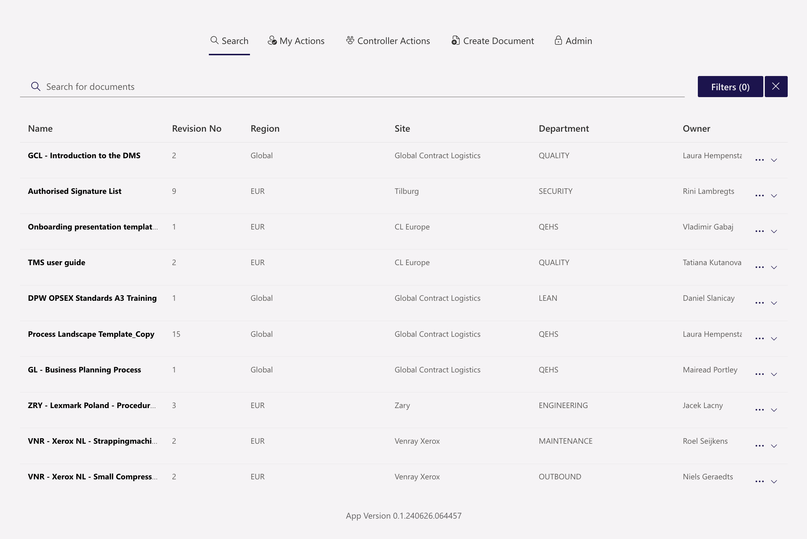

# DPWorld Global Logistics DMS Solution

>**Note**  
To see in-depth documentation, please visit this repo's [wiki page.](https://dev.azure.com/braveandheart/DMS-OPS/_wiki/wikis/DMS-OPS.wiki/1/DPWorld-Global-Logistics-DMS-Solution-Documentation)

A SharePoint Framework (SPFx) document management solution built on top of SharePoint Online, integrating with a custom Azure-based API (Azure Function App + Azure SQL Server) and Microsoft Graph.

Provides functionality for searching, approving, reviewing, and managing change requests on documents.

## Solution

| Solution    | Author(s)                   | Description      |
| ----------- | --------------------------- | ---------------- |
| DMS-OPS     | Samuel Short, Max Monkman   | SPFx Application Code |
| DMS-API     | Samuel Short                | DMS API Azure Function App Code |

## Versions & Prerequisites

| Software | Version |
| -------- | ------- |
| SPFx     | 1.18.2  |
| NodeJS   | 18.x    |
| .NET     | 8       |
| Azure Function Runtime | v4 |

## Quick Start Guide

1. Clone this repository to your local machine
2. Navigate to the root folder of the cloned repository
3. In the terminal run:
  * `npm install gulp-cli yo @microsoft/generator-sharepoint spfx-fast-serve -g`
  * `spfx-fast-serve`
  * `npm install`
  * `gulp set-env --name "<ENV_NAME>"`
    * This is a custom gulp command that updates `src/config/constants.ts` and `package-solution.json` in the DMS-OPS (SPFx) solution to use the correct configuration for one of the following environment arguments:
      * `"BH"` - Brave & Heart
      * `"DPW-Dev"` - DPWorld Dev (braveDashboardDev site only)
      * `"DPW-Prod"` - DPWorld Production (all sites)
  * `npm run serve` *(preconfigured to use hotRefresh - HMR)*
4. Go to the SharePoint workbench to access the locally hosted app (e.g. [braveDashboardCLGlobal](https://braveandheartcom.sharepoint.com/sites/braveDashboardCLGlobal/_layouts/workbench.aspx))

## Environments
| Environment | Account                              | Site URL    | Notes |
| ----------- | ------------------------------------ | ----------- | ----- |
| Dev (B&H)   | sam.short@braveandheart.com (Keeper) | Multiple Sites (e.g. [B&H - Global Contract Logistics](https://braveandheartcom.sharepoint.com/sites/braveDashboardCLGlobal)) |  |
| UAT (DPW)   | svc.bhdev@dpworld.com (keeper)       | [DMS Dev](https://dpworld.sharepoint.com/sites/braveDashboardDev) | Requires Microsoft Authenticator (David Parkinson @ B&H) |
| Prod (DPW)  | svc.bhdev@dpworld.com (keeper)       | Multiple Sites (e.g. [DPW - Global Contract Logistics](https://dpworld.sharepoint.com/sites/braveDashboardCLGlobal)) | Requires Microsoft Authenticator (David Parkinson @ B&H) |

> **Note**: Azure Dev environment exists on B&H's Azure tenant under the resource group `DMS-DEVRSG`. The UAT and Prod resources exist on DP World's Azure tenant to which no external access is granted. Additionally, DP World have their own standards around deployment & resource naming convention.

## Version history

| Version | Date             | Comments        |
| ------- | ---------------- | --------------- |
| 1.0     | July 12, 2024    | Initial Release |

---